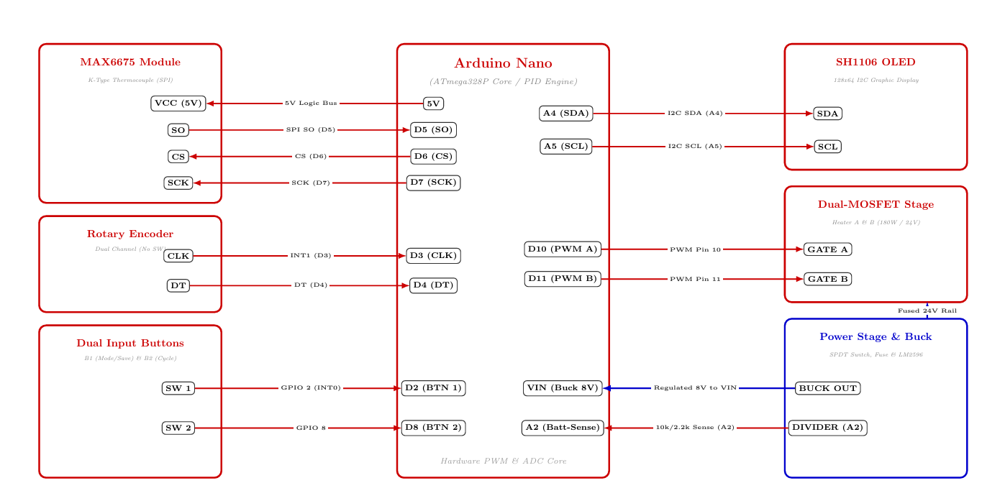

# Smart Closed-Loop PID Thermal Controller (24V / 180W)

A robust embedded closed-loop temperature control system engineered around the **Arduino Nano (ATmega328P)**. The system regulates dual high-power heating channels driving up to 180W at 24VDC with high thermal stability, real-time dynamic PID gain scheduling, SPI thermocouple acquisition, and dual-source battery telemetry.

---

## Academic & Engineering Context

- **Course:** Bachelor of Engineering (B.E.) in Electronics and Communication Engineering
- **Semester:** Semester 6
- **Domain:** Power Electronics, Embedded Control Systems, Closed-Loop PID Control
- **Key Focus:** Power MOSFET switching, SPI sensor interfacing, interrupt-driven rotary user interfaces, and non-volatile parameter persistence.

---

## Key Features

- **Dual-MOSFET Power Switching Stage:** Independent PWM switching driving high-current heating elements with reverse flyback protection.
- **Precision Temperature Feedback:** SPI-driven **MAX6675** cold-junction compensated K-type thermocouple interface ($0^\circ\text{C}$ to $500^\circ\text{C}$).
- **Dynamic & Manual PID Engine:**
  - Dynamic gain scheduling: Automatically adjusts $K_p$, $K_i$, and $K_d$ according to setpoint temperature thresholds.
  - Manual override tuning: Real-time on-the-fly gain adjustment via rotary encoder.
  - Anti-windup protection and integral clamping within narrow error bands ($\pm 12^\circ\text{C}$).
- **Non-Volatile Configuration (EEPROM):** Saves temperature setpoint, manual PID gains, and mode flags with checksum and bound validation.
- **Dual Power Source Architecture & Battery Monitor:**
  - 3-position SPDT selection between 24V Mains SMPS and portable 24V Lead-Acid battery pack.
  - Inline fast-blow safety fuse ($10\text{A}$) downstream of selector switch.
  - Analog voltage divider network ($10\text{k}\Omega / 2.2\text{k}\Omega$) on pin `A2` for real-time pack voltage and charge percentage telemetry.
- **High-Density OLED Interface:** **SH1106 128x64 I2C display** driven by U8g2, featuring real-time process value (PV), set value (SV), PID gains, power supply mode, and graphical heating intensity indicators.

---

## System Architecture & Circuit Schematic

### Circuit Connection Diagram


> **Note:** The complete high-resolution vector PDF schematic is archived under [`docs/Heater_Controller_Circuit_Diagram.pdf`](docs/Heater_Controller_Circuit_Diagram.pdf).

---

## Hardware Pinout & Wiring Matrix

| Subsystem / Component | Module Pin | Arduino Nano Pin | Voltage Rail | Description |
| :--- | :--- | :--- | :--- | :--- |
| **MAX6675 Thermocouple** | **VCC / GND**<br>**SO**<br>**CS**<br>**SCK** | `5V` / `GND`<br>**D5**<br>**D6**<br>**D7** | `5VDC` Logic | SPI cold-junction compensated thermal acquisition |
| **Rotary Encoder** | **CLK**<br>**DT** | **D3**<br>**D4** | `5VDC` Logic | Interrupt/quadrature dial for parameter navigation (No switch used) |
| **User Input Buttons** | **SW 1**<br>**SW 2** | **D2** (INT0)<br>**D8** | `5VDC` Pull-up | Button 1: Mode toggle & 3s Long-press SAVE<br>Button 2: Parameter cycle ($K_p \rightarrow K_i \rightarrow K_d$) |
| **SH1106 OLED Display** | **SDA**<br>**SCL** | **A4**<br>**A5** | `5VDC` Logic | 128x64 Graphical UI over Hardware I2C |
| **Dual-MOSFET Drivers** | **GATE A**<br>**GATE B** | **D10**<br>**D11** | $5\text{V}$ Logic / $24\text{V}$ Power | Hardware Timer1 PWM switching stage driving 180W load |
| **Power Stage & Buck** | **BUCK OUT**<br>**DIVIDER** | **VIN**<br>**A2** | $8\text{V}$ Regulated<br>$0\text{V} - 5\text{V}$ Analog | LM2596 stepping down 24V to 8V for Nano VIN;<br>$10\text{k}/2.2\text{k}$ divider for 24V battery monitoring |

---

## Software & Library Requirements

- **Platform:** Arduino IDE / VS Code + PlatformIO
- **Core Microcontroller:** ATmega328P (Arduino Nano)
- **Required Libraries:**
  - `U8g2lib` (OLED rendering)
  - `max6675` (Thermocouple SPI reader)
  - `Encoder` (Quadrature encoder library)
  - `EEPROM` (Built-in AVR storage)

---

## Project Structure

```text
Smart-PID-Heater-Controller/
├── .gitignore
├── LICENSE
├── README.md
├── Smart-PID-Heater-Controller.ino
└── docs/
    ├── Smart-PID-Heater-Controller.png
    └──Smart-PID-Heater-Controller.pdf